<p align="center">
  
</p>

<p align="center">
  <a href="./README.md">English</a> | <a href="./README.zh-CN.md">简体中文</a>
</p>

<p align="center">
  让 Jellyfin 更轻盈，也更流畅。
</p>

<p align="center">
  
  
  
</p>

---

## 项目简介

**Jellyfish Lite** 是基于 [n00bcodr](https://github.com/n00bcodr) 开发的 [Jellyfish](https://github.com/n00bcodr/Jellyfish) Jellyfin 主题制作的性能优化版本。

原版 Jellyfish 为 Jellyfin 带来了鲜明而精致的视觉风格。Jellyfish Lite 在保留这套设计的基础上，将优化重点放在了另一个方向：**让日常浏览更加流畅，同时尽可能保留原有的视觉体验。**

Lite 并不试图重新设计 Jellyfish，而是通过精简高开销 CSS 效果和不必要的动画，降低浏览器的渲染负担。

**还是那只小水母，只是游得更轻快了。** 🪼

## Lite 有什么不同？

### 更轻量的视觉效果

Jellyfish Lite 主要针对以下 CSS 效果进行了精简或优化：

- 高开销的背景毛玻璃模糊
- 持续运行的背景动画
- 大范围装饰性辉光
- 不必要的悬停动画和过渡效果
- `will-change` 等常驻渲染提示

必要的界面状态反馈和功能性过渡仍尽可能保留。

### 熟悉的 Jellyfish 设计

Lite 致力于保留原版的主要视觉与使用体验：

- 原有布局与响应式设计
- 全部 15 套原版配色
- 原有字体、图标及视觉风格
- 对原版可选主题组件的兼容支持

我们的目标是优化，而不是重新设计。

### Nico 的一点小改造

Jellyfish Lite 增加了由 Nico 自行设计的 SVG Logo。

通过 CSS Mask，Logo 可以使用当前主题的强调色显示。同时，Logo 的选择与主题配色相互独立，提供三种模式：

- **Nico Remix**：随主题强调色变化的自绘 SVG Logo
- **Original Jellyfish**：原版 Jellyfish Logo
- **Streamberry**：Streamberry 替代 Logo

### 一些实用的小调整

- 默认显示详情页操作按钮的文字标签
- 默认加载彩色家长分级样式
- 主主题只需导入一个 CSS 入口
- 其他可选组件仍可按需启用

**注意：** 彩色家长分级需要配合 `rating.js` 脚本才能实际着色。如果未安装脚本，将使用默认的后备样式。

## 快速安装

以管理员身份进入 Jellyfin 后台，打开：

**控制台 → 常规 → 自定义 CSS 代码**

添加以下内容：

```css
@import url("https://cdn.jsdelivr.net/gh/mumuer1024/Jellyfish@main/lite/theme.css");
```

保存设置并刷新 Jellyfin 页面即可。

Lite 的主主题、默认配色及已集成样式均通过这一个入口加载，无需逐个导入。

如果需要为单独用户配置主题、切换配色、选择 Logo 或启用其他组件，请参阅详细使用说明。

> **版本提示：** 上述地址跟随 `main` 分支的最新内容。正式版本发布后，建议使用固定版本标签，以避免后续更新意外影响现有主题。

## 个性化设置

Jellyfish Lite 完整保留了原版的 15 套配色：

`aurora` · `banana` · `coal` · `coral` · `forest` · `grass` · `jellyblue` · `jellyflix` · `jellypurple` · `lavender` · `midnight` · `mint` · `ocean` · `peach` · `watermelon`

默认配色为 **JellyBlue**。

Logo 可以独立于配色方案切换，无需因为更换颜色而更换 Logo。

关于配色、Logo 模式、可选 CSS 组件、配套脚本及故障排查，请参阅：

**[详细使用说明](./lite/README.zh-CN.md)** · **[English Documentation](./lite/README.md)**

## 兼容性

Jellyfish Lite 主要面向 **Jellyfin 10.11 及更新版本**，并保留了上游主题对 Jellyfin 12 界面的样式支持。

不同 Jellyfin 客户端、插件及自定义配置可能带来兼容性差异。

Lite 已在实际 Jellyfin 环境中完成手动验收。在海报网格、剧集列表等页面，相比原版观察到了更流畅的滚动体验。不过，这些体验反馈并不等同于适用于所有设备的性能基准测试。

Jellyfin 管理后台的自定义 CSS 存在独立限制，这一点与原版主题相同。

## 项目文档

| 文档 | 内容 |
|---|---|
| [详细使用说明](./lite/README.zh-CN.md) | 安装、配置、可选功能 |
| [English Guide](./lite/README.md) | 英文详细说明 |
| [技术审计](./AUDIT.md) | CSS 优化细节与开发记录 |
| [原版 README](./README.upstream.md) | 原作者的完整说明 |
| [原版 Jellyfish](https://github.com/n00bcodr/Jellyfish) | 上游项目仓库 |

## 致谢与许可

Jellyfish Lite 是基于 **[n00bcodr 的 Jellyfish](https://github.com/n00bcodr/Jellyfish)** 制作的非官方社区修改版本。

原版 Jellyfish 受到 Flow、Zesty、Ultrachromic 等社区主题的启发。原始设计及上游贡献的相关权益归各自创作者所有。

**Lite 修改与性能优化：** Nico，借助 AI 辅助开发完成。

**Lite 自定义 Logo：** Nico。

本项目保留原版仓库的 [LICENSE.md](./LICENSE.md)。修改或再分发前，请阅读原项目采用的 **DBAD Public License**。

本项目不代表 Jellyfin 官方，也不代表原版 Jellyfish 作者的官方发布。

---

<p align="center">
  <strong>Jellyfish Lite — Remixed by Nico</strong>
</p>

<p align="center">
  愿每一只小水母，都能游得轻快一点。🪼
</p>
